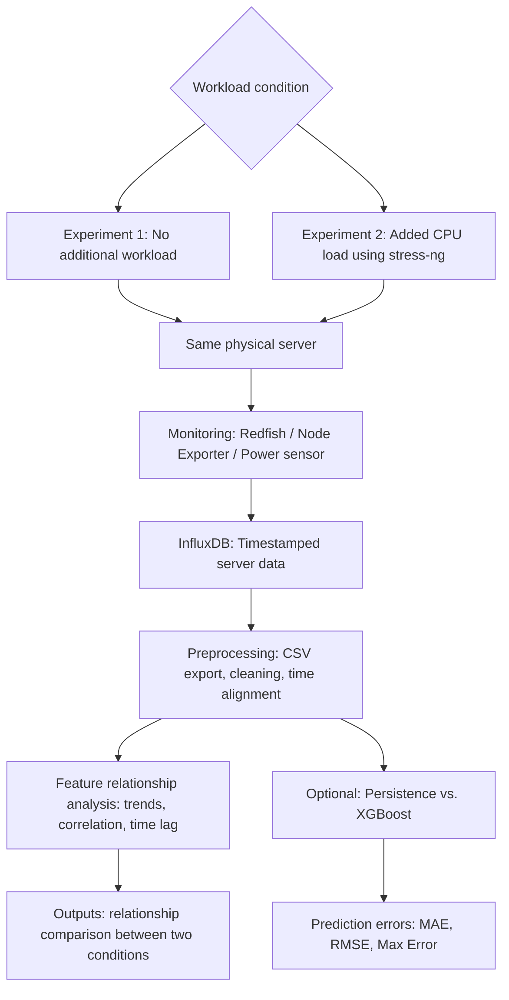

# Project Planning: Server Temperature Prediction and Feature Relationship Analysis

## Table of Contents

- [Reference](#reference)
- [Basic Information](#basic-information)
- [Part A. Detailed Project Planning](#part-a-detailed-project-planning)
  - [A1. Project Summary](#a1-project-summary)
  - [A2. System Architecture](#a2-system-architecture)
    - [System Assumptions](#system-assumptions)
    - [Environment](#environment)
    - [Input Parameters](#input-parameters)
    - [Output Parameters](#output-parameters)
    - [Proposed Monitoring and Analysis Modules](#proposed-monitoring-and-analysis-modules)
    - [System Block Diagram](#system-block-diagram)
  - [A3. Expected Deliverables and Validation](#a3-expected-deliverables-and-validation)
    - [Expected Deliverables](#expected-deliverables)
    - [Validation Method](#validation-method)
    - [Experiment Scenario 1: No Additional Workload](#experiment-scenario-1-no-additional-workload)
    - [Experiment Scenario 2: Added CPU Workload](#experiment-scenario-2-added-cpu-workload)
  - [A4. Cross-Validation](#a4-cross-validation)
    - [Main Risks and Mitigation](#main-risks-and-mitigation)
- [Difference from the Referenced Studies and Scope Rationale](#difference-from-the-referenced-studies-and-scope-rationale)

## Reference
1. [K. Zhang et al., "Machine Learning-Based Temperature Prediction for Runtime Thermal Management Across System Components," in IEEE Transactions on Parallel and Distributed Systems, vol. 29, no. 2, pp. 405-419, 1 Feb. 2018, doi: 10.1109/TPDS.2017.2732951.​](https://ieeexplore.ieee.org/document/7995115)
2. [S. Ilager, K. Ramamohanarao and R. Buyya, "Thermal Prediction for Efficient Energy Management of Clouds Using Machine Learning," in IEEE Transactions on Parallel and Distributed Systems, vol. 32, no. 5, pp. 1044-1056, 1 May 2021, doi: 10.1109/TPDS.2020.3040800.​](https://ieeexplore.ieee.org/document/9272657)
3. [Lin J, Lin W, Lin W, Wang J, Jiang H. Thermal prediction for air-cooled data center using data driven-based model. Applied Thermal Engineering. 2022 Nov 25;217:119207.​](https://www.sciencedirect.com/science/article/abs/pii/S1359431122011395)

---

# Basic Information

| Item | Information |
|---|---|
| Project Title | Feature Relationship Analysis for Server Temperature Prediction Under Two Workload Conditions |
| Student ID / Name | M11502273 / Chynna |
| Git Repository / Project Link | [MWN-2026-M11502273-Chynna](https://github.com/yihsunnnn/MWN-2026-M11502273-Chynna) |
| Planning Approval Date | YYYY-MM-DD (The project starts being evaluated after approval by both instructors.) |

---

# Part A. Detailed Project Planning

## A1. Project Summary

- **Problem to be solved:** Server temperature is related to multiple operating measurements, including CPU utilization, power consumption, and fan speed. However, these features do not always change in the same way, and their relationships may differ when the server is idle or running an additional workload. This project aims to observe these relationships using real server monitoring data and determine whether adding a CPU workload changes the temperature patterns and the usefulness of different input features.

- **Key challenges:** Server temperature may react later than CPU utilization or power consumption. Fan speed may also change as the cooling system responds to rising temperature. Monitoring measurements can have different timestamps, missing values, or noise, making direct comparisons difficult. Moreover, a correlation between two features does not prove that one feature causes the other to change.

- **Proposed method:** Use CortexDC-related monitoring sources, such as Redfish, Node Exporter, and available power monitoring, to collect time-aligned measurements from Lavoisier and store them in InfluxDB. Perform only two experiments on that server: **(1) no additional workload** and **(2) an added CPU workload using `stress-ng`**. Compare CPU temperature, CPU utilization, power, and fan speed between the two conditions. Use time-series plots, correlation analysis, and lag analysis. As a supporting check, compare Persistence with XGBoost and examine whether the input features help predict future CPU temperature.

- **Expected outcomes:** Obtain two comparable datasets, identify the features most closely associated with temperature changes, and observe whether the relationships differ with and without added load. Report measured temperature trends, time delays, correlations, and prediction errors without assuming in advance that a more complex model will perform better. No O-RAN integration, workload scheduling, cooling control, or energy-saving claims are included.

---

## A2. System Architecture

### System Assumptions

- **Lavoisier is the only server monitored in this project.** Both experiments use this same physical server and the same monitoring configuration and sensor definitions; Quine, Maxwell, and Davinci are not test or comparison servers.
- **No additional workload** means no workload intentionally generated by this project; ordinary background system activity may still exist.
- **Added workload** means a documented CPU stress test generated by `stress-ng` on the monitored server.
- A consistent sampling and resampling interval is used for both conditions. A **5-minute analysis interval** is proposed, subject to sufficient raw data availability.
- Ambient/cooling conditions should be kept as similar as practical; unavoidable changes are recorded as limitations.
- Temperature predictions, if evaluated, use only information available at or before the prediction time.

### Environment

- **Monitored physical server:** Lavoisier, in BMW Old-Rack, with one Intel Xeon Gold 6433N CPU. The available inventory lists CPU-temperature, Redfish power, and fan-RPM telemetry (fans 1–3). CPU-usage collection must be confirmed before testing. Inlet-temperature and outlet-temperature data are listed as unavailable; they are not required inputs for this project.
- **Server scope:** Collect and analyze telemetry from Lavoisier only. The project compares the no-additional-workload condition with a CPU workload generated by `stress-ng`; it does not use e2e traffic testing.
- **Workload generator:** `stress-ng` on the monitored server for the loaded experiment; no intentional load generation for the baseline experiment.
- **Monitoring interfaces:** Node Exporter, Redfish/BMC, and an available PDU/power sensor when applicable.
- **Data storage:** InfluxDB for timestamped measurements and CSV export.
- **Analysis environment:** Python 

### Input Parameters

| Parameter | Meaning | Role |
|---|---|---|
| `CPU_temperature` (°C) | CPU temperature | Target for prediction; also an observed feature |
| `CPU_usage` (%) | CPU utilization | Workload indicator |
| `Server_power` (W) | Server power consumption, if available | Heat-related feature |
| `Fan_RPM` (RPM) | Fan rotation speed | Cooling-response feature |
| `Timestamp` | Measurement time | Synchronization and lag analysis |
| `Workload_condition` | No additional load / Added CPU load | Experiment label |

### Output Parameters

- **Measured trends:** CPU temperature, CPU usage, server power, and fan speed over time.
- **Temperature changes:** Difference in temperature levels and variability between the two conditions.
- **Feature relationships:** Correlation coefficients and time-lag relationships with CPU temperature.
- **Optional model output:** Predicted CPU temperature at a defined future horizon, e.g., 10 minutes.
- **Prediction metrics:** MAE, RMSE, and Max Error when models are evaluated.

### Proposed Monitoring and Analysis Modules

1. **Workload Module:** Distinguishes no additional load from added CPU load.
2. **Monitoring Module:** Collects timestamped measurements from the server.
3. **Storage and Preprocessing Module:** Exports CSV data, handles missing values, aligns timestamps, and resamples data.
4. **Relationship Analysis Module:** Draws time-series plots and computes correlations and lag relationships.
5. **Optional Prediction Comparison Module:** Evaluates Persistence and XGBoost using the same time-based split and metrics.

### System Block Diagram

---

## A3. Expected Deliverables and Validation

### Expected Deliverables

- Two timestamped CSV datasets collected from Lavoisier: **no additional load** and **added CPU load**.
- Reproducible collection and preprocessing instructions, including sensor names, units, and missing-value handling.
- Time-series comparison graphs for the available common features.
- Correlation and lag-analysis results for each workload condition.
- Optional Persistence and XGBoost prediction results under identical evaluation rules.
- A short report summarizing which feature relationships changed between the conditions and which interpretations remain uncertain.

### Validation Method

- **Experimental environment:** Lavoisier only, monitored using existing Redfish/Node Exporter/InfluxDB infrastructure.
- **Condition control:** Use Lavoisier and the same monitoring setup for both experiments; record background processes and changes in ambient conditions where possible.
- **Workload model:** No intentionally generated workload in Experiment 1; controlled CPU stress using `stress-ng` in Experiment 2. The stress configuration and actual CPU usage must be recorded.
- **Sampling policy:** Use available raw monitoring data and resample consistently to 5-minute intervals for comparison; preserve raw measurements for transient/lag checks.
- **Duration and repetition:** Run the two conditions for comparable periods, recording exact start/end timestamps. Repetition is recommended when possible; no measured duration or repeat count is assumed before execution.
- **Analysis metrics:** Pearson/Spearman correlation where appropriate, estimated lag at strongest cross-correlation, mean/maximum/standard deviation of temperature, and optional prediction MAE/RMSE/Max Error.
- **Prediction split:** If predicting, use a chronological 70%/15%/15% train/validation/test split within the appropriate experimental dataset. Compare both models on identical test periods; do not leak future data into lag features.
- **Reproducibility record:** Lavoisier identity/specifications, sensor names/units, `stress-ng` command and configuration, actual CPU usage, collection timestamps, resampling interval, XGBoost settings, and random seed if relevant.
- **PHY/MAC parameters:** Not applicable: this project measures server telemetry

### Experiment Scenario 1: No Additional Workload

- **Design:** Keep the monitored server in its ordinary operating state without starting `stress-ng`, `iperf`, or another experiment-generated workload. Record CPU usage, CPU temperature, available server power, and fan RPM.
- **Comparison reference:** This is the **baseline condition** for Experiment 2.
- **Purpose:** Establish the natural variation of each feature and identify relationships during relatively low-load operation.
- **Analysis:** Plot the available measurements against time; compute temperature statistics and feature correlations. If sufficient time-series variation exists, examine lag relationships and optional prediction errors.
- **Expected observations (hypotheses, not measured results):** CPU usage and power may vary less than under stress; CPU temperature may be more stable. Correlations may be weak or uncertain if the available feature variation is too small.

### Experiment Scenario 2: Added CPU Workload

- **Design:** Generate a documented CPU workload with `stress-ng` on the same server while collecting the same measurements. Record the test command, CPU utilization achieved, stress start/end times, and any cooling or background changes.
- **Comparison:** **Added CPU load vs. no additional load (Experiment 1)**. Use identical sensor definitions, processing rules, and comparable observation periods.
- **Purpose:** Observe whether added workload changes CPU temperature, power, fan behavior, and their correlations or time delays.
- **Analysis:** Overlay or align plots from both conditions; compare mean/max/variability, correlations, and possible time lags. If models are evaluated, compare Persistence and XGBoost with the same features and forecast horizon.
- **Expected observations (hypotheses, not measured results):** CPU utilization will rise if stress generation works; power and temperature may increase, with a delayed thermal response. Fan speed may react as part of cooling control. The size and even direction of these relationships must be measured rather than assumed.

---

## A4. Cross-Validation

1. **Can the proposed contributions address the identified challenges?**
2. **Do the planned experiments provide sufficient evidence that the proposed method solves the problem?**

| Validation Question | Analysis | Conclusion |
|---|---|---|
| **Can the proposed contributions address the identified challenges?** | **Complex feature relationships:** Consistent measurements under two conditions allow direct comparison of CPU utilization, power, fan speed, and CPU temperature. **Time delay:** Lag analysis can detect whether changes in one monitored feature tend to precede temperature changes at the available sampling resolution. **Data quality:** Timestamp alignment, common sensor definitions, and missing-data reporting reduce misleading comparisons. **Interpretation:** Correlation and model importance indicate statistical relationships, not proof of physical causation. | **Yes, for an exploratory comparison**, subject to data quality. |
| **Do the planned experiments provide sufficient evidence that the proposed method solves the problem?** | **Scenario 1** provides a no-added-load reference. **Scenario 2** adds one controlled CPU workload while using the same monitoring and analysis procedure. Together, they can show observed differences in temperature patterns and feature relationships. **Limitations:** Background activity, ambient cooling changes, limited duration, and single-server sampling may affect the results. These experiments cannot establish general causal effects for all servers or prove energy savings. | **Partially validated after data collection**; evidence will be sufficient for a limited two-condition observational study if conditions are comparable. |

### Main Risks and Mitigation

| Risk | Mitigation |
|---|---|
| Missing or inconsistent sensor data | Align by timestamp, keep units consistent, report missing percentages. |
| Stress test does not change CPU usage enough | Verify actual CPU utilization and record the workload command. |
| Different room or cooling conditions between tests | Record test timestamps and note known environmental or cooling changes; interpret differences cautiously because these conditions are not modeled as input features. |
| Correlation caused by a shared trend rather than a direct relationship | Compare aligned time series and differenced series when appropriate; avoid causal claims. |
| Too few samples to estimate time lag or train XGBoost | Report the limitation; treat optional prediction comparisons as exploratory. |

---

## Difference from the Referenced Studies and Scope Rationale

- **Why inlet temperature is excluded:** The project is focused on telemetry available from the monitored server and comparing the same sensor set across both experiments. An inlet-temperature sensor not be exposed or consistently available through the existing monitoring setup. Excluding it avoids making the experiment depend on an optional sensor; room/cooling changes will instead be noted as limitations when known.
- **Why O-RAN/O-Cloud and related items are excluded:** Adhering to O-RAN standards would require data acquisition in accordance with specific technical specifications; however, establishing the necessary interfaces for such data collection is a time-consuming process. Therefore, O-RAN standards have been excluded from this project.
