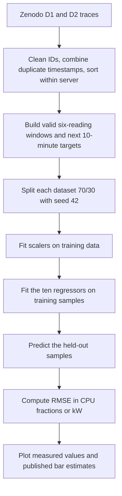

# Flowchart and source code



## Run Figure 14a

Tested on Windows with Python 3.14.6 and PyTorch 2.15.0+cpu. From the A4 directory, use a Python environment with these dependencies.

```powershell
python -m pip install -r src/requirements.txt
python -m pip install torch==2.15.0+cpu --index-url https://download.pytorch.org/whl/cpu
```

Download `dataset1_combined.csv` and `dataset2_combined.csv` into `A4/data/datasets/combined/`. [Zenodo data](https://zenodo.org/records/10069402)

```powershell
python src/reproduce_cpu.py --plot-existing
python src/reproduce_cpu.py
```

The first command redraws the archived Figure 14a without training. The second uses the full data and fits all ten CPU regressors separately for D1 and D2. Both write into `A4/rerun/`. CPU training can take several minutes and floating-point results may vary with hardware and thread scheduling.

The archived Figure 14b can be redrawn with `python src/replot_power.py`. To train the original three-epoch configurations again, run `python src/fig14.py --split random --rf-train-limit 0`. This trains both CPU and power models and reports training-range RMSE. Divide the power results in watts by 1,000 for the archived kW scale. [Training code](fig14.py) · [Statistical figures script](fig5_to_fig13.py) · [Published notebook](https://github.com/shashikantilager/data-center-characterization/blob/main/analysis.ipynb)
