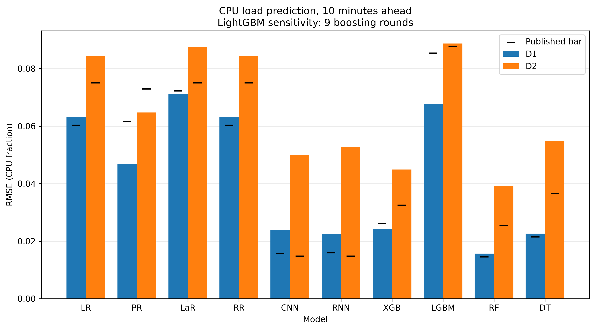
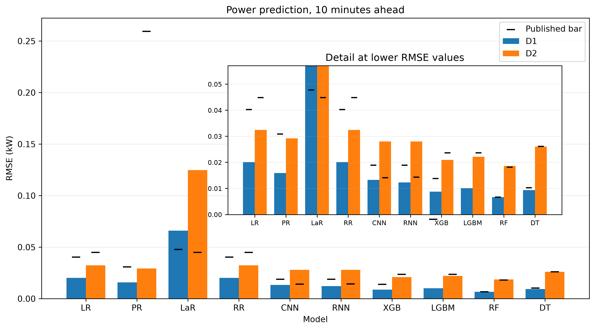

# A4 — Data Center Baseline Reproduction

The baseline predicts a physical server's CPU load and power consumption ten minutes ahead. I use the public D1 and D2 telemetry from Ilager et al. as a reference for the later temperature-prediction project. The power baseline uses CPU temperatures as inputs. The baseline's prediction targets are CPU load and power. [Paper, Section 6](https://hpc.ec.tuwien.ac.at/files/UCC_23_data_center_analysis.pdf#page=8) · [Public dataset](https://zenodo.org/records/10069402)

## System model and implementation

D1 and D2 are evaluated separately. Inputs shared by both datasets are CPU 1 and CPU 2 temperature, RAM used, CPU cores used, network RX and TX, and running VM count. D1 additionally includes inlet temperature and four fan speeds. The current CPU and power readings, total RAM, and total core count are excluded from model inputs.

I sort by server and time after consolidating duplicate server timestamps by averaging. A sample must have six valid consecutive input readings and a valid target exactly one 10-minute interval later on the same server. CNN and LSTM use all six input readings. The other models use the last input reading. StandardScaler is fitted on the training partition. Targets are scaled using the training minimum and maximum, except that the revised CPU Lasso is trained in CPU percentage units.

I use a random 70/30 holdout with NumPy seed **42**. The plotted scores are from **one fitted run per dataset, target and model** for the selected configurations. Figures 14a and 14b show 20 scores each. The reduced-round LightGBM score is computed from the first nine rounds of the same 100-round fit. These plots give single-split estimates.

| Task | D1 train / test | D2 train / test |
|---|---:|---:|
| CPU | 1,855,844 / 795,362 | 671,567 / 287,815 |
| Power | 1,855,843 / 795,362 | 671,549 / 287,807 |

| Model | Main configuration |
|---|---|
| LR / PR | Linear regression with intercept. PR uses degree-two features and interactions, with no extra bias column. |
| LaR / RR | Lasso and Ridge use alpha 1. CPU Lasso uses unscaled CPU percentage targets. |
| CNN | CPU uses two 64-channel convolutions with kernel size 3, ReLU, and a 64-unit dense layer. The archived power run uses one 32-channel convolution. |
| RNN | One LSTM layer, hidden size 64 for CPU and 32 for power, followed by a linear output. |
| XGB | XGBoost squared-error regression with package defaults and seed 42. |
| LGBM | GBDT with learning rate 0.1, 31 leaves, and seed 42. CPU uses the first 9 of 100 rounds for the sensitivity chart. Power uses all 100 rounds. |
| RF / DT | Squared-error splits, unrestricted depth, minimum split size 2 and minimum leaf size 1. RF uses 100 bootstrap trees. Both use seed 42. |

Neural networks use Adam with learning rate 0.001, training batch size 2,048, MSE loss, and seed 42. CPU training uses 18 epochs. The archived power experiment uses 3. [Full estimator settings for the CPU figure](results/model_parameters.json) · [Flowchart and source](src/README.md)

## Numerical results

CPU RMSE is shown as a fraction of the 0–100% CPU scale. For example, 0.02388 is 2.388 CPU percentage points. Power RMSE is in kW. Colored bars show test results from my runs. Black marks are approximate heights read from the authors' published plots. The paper describes RMSE but does not specify its scaling formula.

### CPU load, Figure 14a

| Model | D1 reproduced | D1 paper bar | D2 reproduced | D2 paper bar |
|---|---:|---:|---:|---:|
| CNN | 0.02388 | 0.01578 | 0.04986 | 0.01482 |
| LSTM | 0.02246 | 0.01593 | 0.05270 | 0.01479 |
| LightGBM, 9 rounds | 0.06784 | 0.08538 | 0.08873 | 0.08779 |
| Random Forest | 0.01568 | 0.01456 | 0.03921 | 0.02542 |

Random Forest has the lowest measured CPU RMSE in both datasets for the displayed configurations. The CPU neural-network results still differ from the paper, especially on D2. The 9-round LightGBM setting was selected by proximity to the published bars across both datasets. The default 100-round LightGBM scores are 0.02880 for D1 and 0.04750 for D2. [All 20 CPU scores](results/cpu_comparison.csv)

### Power consumption, Figure 14b

Random Forest gives the lowest measured power RMSE on both datasets, about **6.63 W** on D1 and **18.61 W** on D2. The corresponding published graphical estimates are 0.00668 and 0.01817 on the paper's plotted scale. The paper's prose gives 0.0016 for D1, so the graphical estimate and prose value are recorded separately. [All archived CPU and power scores for this configuration](results/closest_setting.csv)

## Limitations

The authors' public notebook provides the statistical workflow. The Figure 14 training implementation, exact split, neural architecture and RMSE normalization formula are unreported in the published materials inspected. The fitted models, scales, and selected LightGBM rounds are therefore documented as reproduction choices. The random split can put adjacent windows from one server on opposite sides of the split. Its scores describe a random holdout within the recorded period. [Author notebook](https://github.com/shashikantilager/data-center-characterization/blob/main/analysis.ipynb)
